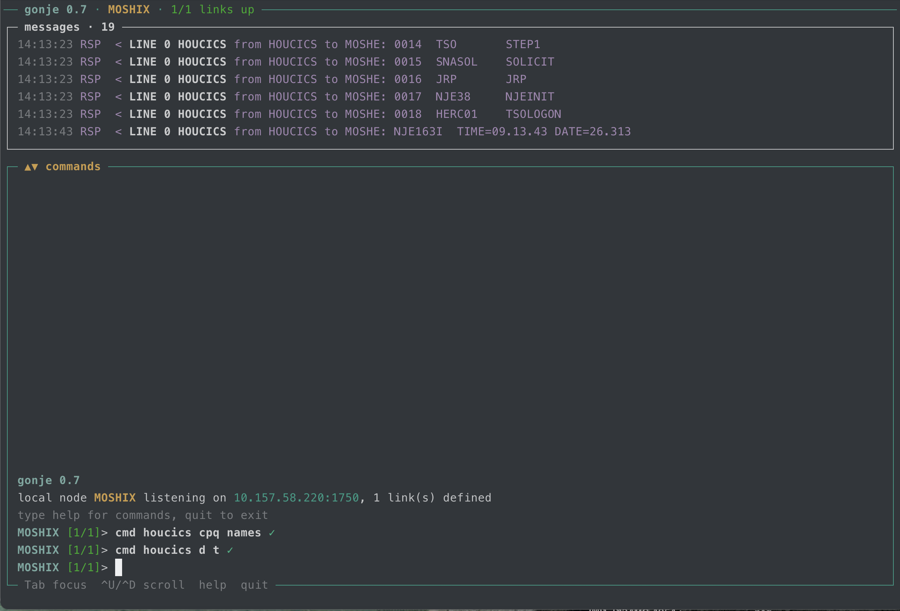

# goNJE

goNJE is an IBM NJE (Network Job Entry) node that speaks NJE over
TCP/IP, as defined by the IBM protocol spec in
[this manual](https://www.ibm.com/docs/en/SSLTBW_2.5.0/pdf/hasa600_v2r5.pdf).

It connects to other NJE nodes (RSCS, JES2, NJE38, another gonje), sends
and receives messages, commands and files, and lets you do that through
an operator shell or in batch mode.

## Build

    go build -o gonje ./cmd/gonje
    go test -race ./...

| Script | What it does |
|---|---|
| `./build.sh` | builds `bin/gonje-<version>-<os>-<arch>` for linux/amd64, linux/arm64 and darwin/arm64 (static, CGO off) |
| `./start.sh [args]` | runs the highest-version binary in `bin/` for this machine; arguments go to gonje, e.g. `./start.sh -c test/nodeA.cnf` |

## Configure

    cp gonje.cnf.example gonje.cnf

`key=value` pairs separated by newlines, spaces or commas. A word that
starts with `#` starts a comment (a `#` inside a value is kept). Keys
are case-insensitive and `-` may be written for `_`. Unknown keys are
logged and ignored.

### General keys

| Key | Meaning (default) |
|---|---|
| `local_node` | our NJE node name, 1-8 characters |
| `local_IP`, `local_port` | where we listen (0.0.0.0, 175) |
| `send_dir` | where `ls` and `send` look for files (./outbox) |
| `recv_dir` | where received files are stored (./inbox) |
| `log_level` | debug, info, warn or error (debug) |
| `panel_level` | event detail on screen: 1, 2 or 3 (1) |
| `split_view` | yes/no: start in split view (yes) |
| `split_ratio` | events pane share of the events + command rows, in percent (40) |
| `msg_pane` | rows of the messages pane, 3-50 (6) |
| `msg_bell` | yes = ring the terminal bell on incoming messages (no) |
| `timeout` | give up on a remote not reached for this many seconds; 0 = never (0) |
| `route` | `route=<dest>,<via>[,<alt>]`: reach a node through a linked one (alt when via is down); one per destination |
| `default_route` | `default_route=<node>`: where every other node is sent (must be a defined remote) |

### Remote node keys

`remote_host_name` starts a block; the keys after it belong to that
remote.

| Key | Meaning (default) |
|---|---|
| `remote_host_name` | the remote's node name |
| `remote_host_addr` | host or IP; leave out to only accept calls |
| `remote_host_port` | its port (175) |
| `remote_keepalive` | seconds of quiet before a null buffer (10) |
| `remote_password` | node password (never logged) |
| `remote_turn` | `free`: send whenever there is data; `strict`: BSC-style turn-taking (free) |
| `remote_buffersize` | NJE buffer size we offer, 300-32768; we send at most the smaller of ours and the peer's (8192) |
| `remote_max_streams` | concurrent file transfers each way, 1-8 (1) |
| `remote_line` | LINE number 0-999, unique (order in the file from 0) |
| `remote_natin` | NAT: our inside address, used as the dial source |
| `remote_natout` | NAT: our public address, sent in OPEN and ACK |
| `remote_strict_bcb` | yes = a block sequence error sends E0 and drops the link; no = log and resynchronise (no) |

## Run

    ./gonje [-c|-f gonje.cnf] [-o key=value ...] [-split=true|false] [-log gonje.log]

| Flag | Meaning |
|---|---|
| `-c <file>`, `-f <file>` | config file (gonje.cnf); `-c send\|cmd\|msg` selects batch mode |
| `-o key=value ...` | gonje.cnf keys (quotes optional); repeatable |
| `-split=false` | start with a single pane (default from `split_view`) |
| `-log <file>` | log file (gonje.log) |
| `-v` | print `gonje <version>` and exit |
| `-w <s>` | batch `cmd`: seconds to wait for responses (30) |

`-o` takes the same `key=value` tokens as gonje.cnf (separated by
spaces or commas; `remote_host_name` starts a remote block):

    gonje -o local_node=MOSHIX local_IP=10.157.58.220 local_port=1750 remote_host_name=HOUCICS remote_host_addr=10.157.58.220 remote_host_port=4002
    gonje -o local_node=MOSHIX remote_host_name=HOUCICS remote_host_addr=10.157.58.220 -c msg HOUCICS HERC01 hello

- `-o` takes every following `key=value` argument up to the next
  argument that starts with `-` or has no `=`. It may come before or
  after other flags, and after `-c send|cmd|msg` and its operands.
- A token with an unknown key (a typo) is an error.
- Quotes are optional; they only group several tokens into one
  argument, e.g. `-o "local_node=ME remote_host_name=A"`. Values can't
  contain spaces (spaces separate tokens, as in gonje.cnf).
- In batch mode the message or command text must not contain a word
  starting with `-` (it would be read as the next option).

- With `-o`, gonje.cnf is optional (but a file named with `-c`/`-f`
  must exist).
- If there is a config file, `-o` is applied after it: values override,
  a remote named again is extended, a new one is added.
- Errors name `-o` as their source.
- Started without a config file, the first `save` in the shell writes a
  new gonje.cnf (the `-o` settings plus the change).
- Passwords in `-o` are masked in the log, but they are visible in `ps`
  and your shell history.

Only one interactive gonje runs per config file. `gonje.pid` next to the
config holds the pid, version, node, listen address, config path and
start time. It is removed on exit, and a stale one (process gone) is
cleaned up. Without a config file it goes in the current directory, and
"same config" means the same local node and listen address. When the listen port is busy, gonje says who has it: another
gonje (pid, node, start time), an NJE node that answers an OPEN probe,
or another program. It also points out a remote node configured on the
same port.

## Screen

On a terminal gonje uses the whole screen (Unicode frames, or ASCII when
the locale is not UTF-8 or `GONJE_ASCII=1`) and restores it on exit.
Colors follow `NO_COLOR`. Piped (non-tty) use prints plain lines.

Top to bottom:

| Pane | Content |
|---|---|
| title line | version, local node, links up, pending commands, draining |
| events | link and transfer events (`incoming · L2 · live · N events`) |
| messages | white frame: incoming messages and command responses; new tags blink |
| commands | results, then the input line, then the key hints border |

With split off, the messages pane sits above one scrolling pane that
holds results and events together. Below 20x8 the frames are dropped.

`msg`, `cmd` and `send` print no confirmation line. The echoed command
line gets a mark instead:

| Mark | Meaning |
|---|---|
| ` …` | on its way |
| ` ✓` | message or command written to the link; file confirmed by the peer, or no answer within 10 s |
| ` ✗` | failed; an error line follows |

ASCII marks: ` ...`, ` [ok]`, ` [x]`.

Table output (`nodes`, `link list`, `routes`, `stats`, `spool`) never
wraps: less important columns are dropped first, then the last column
is cut with `…`. Long output is paged: `C`, Space, Enter, Down or PgDn
show more; `Q` or Esc stops.

| Key | Action |
|---|---|
| Tab | move the scroll focus: events, messages, commands (start: commands) |
| Ctrl-U / Ctrl-D | scroll the focused pane back / forward |
| Ctrl-G / Ctrl-V (Ctrl-Up / Ctrl-Down) | grow / shrink the events pane |
| Ctrl-L | redraw |
| Up/Down, Ctrl-P/Ctrl-N | history (`~/.gonje_history`, passwords stored as `***`) |
| Ctrl-R | search the history |
| Ctrl-A/Home, Ctrl-E/End | start / end of line |
| Ctrl-B/Left, Ctrl-F/Right | character left / right |
| Alt-B/Alt-F, Ctrl-Left/Right | word left / right |
| Backspace, Delete | delete a character |
| Ctrl-K, Ctrl-W, Ctrl-Y | kill to end, kill word, yank |
| Ctrl-T | transpose characters |
| Ctrl-C | clear the line |

### Panel levels

| Level | Shows |
|---|---|
| L1 | incoming messages, responses, commands and files |
| L2 | L1 plus outgoing traffic, transfer progress, link up/down, signon/signoff, stream control, errors |
| L3 | L2 plus a hex dump of every record; keepalives collapse to one line (`keepalive x12 NODEB`) |

## Shell commands

`help` lists them all; `help <command>` shows details and an example.
Anywhere a node is expected you may give its LINE number instead:
`line 3`, `l3` or `3`.

| Command | Action |
|---|---|
| `nodes` (`status`, `link list`) | show all links |
| `connect <node>` | connect a link and resume auto-reconnect; cancels a drain |
| `drop <node>` | sign off a link, no auto-reconnect |
| `drain <node>` | let running transfers finish, refuse new ones, then drop |
| `link define <node> <addr\|-> [opts] [save]` | add a link (`-` = passive, only accept calls) |
| `link change <node> [addr\|-] [opts] [save]` | change a link (used on the next connect) |
| `link delete <node> [save]` | drop and remove a link (refused while a route uses it) |
| `link reset-framing <node>` | forget the learned DLE STX framing of a link |
| `route <dest> to <via> [alt <alt>] [save]` | reach a node through another link |
| `route delete <dest> [save]`, `route list` (`routes`) | remove / list routes |
| `route default <node>\|delete [save]` | set or remove the default route |
| `msg <node> <user> <text>` | send a message (`*` = the operator) |
| `cmd <node> <command>` | send a command, e.g. `cmd NODEB Q SYS` |
| `send <node> <user> <file>` | send a file (a path, or a name in send_dir) |
| `spool [<id>\|<file>]` | received and forwarded files; details of one |
| `spool delete <id>\|<file>` | delete a received file (and its `.meta`) or a held forward |
| `ls` | list send_dir |
| `inbox` | list recv_dir |
| `local` | show local name, address, port, timeout |
| `local name <node> [save]` | rename the local node (active links sign on again) |
| `local ip <addr> [save]` | listen on another address |
| `local port <n> [save]` | listen on another port |
| `local timeout <s> [save]` | give up on unreachable links after `<s>` seconds (0 = never) |
| `stats [<node>]` | traffic counters: totals plus one row per link, or every counter of one link |
| `stats reset [<node>]` | zero the counters (in memory only) |
| `level 1\|2\|3` | event detail |
| `split on\|off\|<percent>\|msgs <n>` | split view, single pane, events pane share, messages pane rows |
| `log` | show the end of the log file |
| `version` | show the gonje version |
| `help [command]` | list commands, or details of one |
| `quit` | close all links without signoff and exit |

Link options (`link define` / `link change`): `port=<n>`
`keepalive=<s>` `password=<pw>` `strict_bcb=yes|no` `turn=free|strict`
`max_streams=<n>` `buffersize=<n>` `natin=<ip>` `natout=<ip>`
`line=<n>`.

`save` also writes the change to the config file given with `-c`/`-f`.
Other lines, comments and their order are kept. The file is replaced
atomically (through the symlink if it is one) and made 0600 when it
holds a password.

Incoming `Q SYS`, `Q LINKS` and `Q FILES` are answered automatically.
Other commands get "unsupported command".

## Links

- gonje dials every remote that has an address and reconnects after
  errors. With `timeout` set, it gives up and waits for `connect`.
- `remote_turn=free`: data goes out as soon as it is ready, and an idle
  link sends a null buffer every `remote_keepalive` seconds. TCP
  keepalive finds a dead peer (Linux also uses `TCP_USER_TIMEOUT`).
- `remote_turn=strict`: BSC-style turn-taking; 3x keepalive of silence
  means the link is dead.
- `drop` and `drain` sign off; `quit` does not, so peers take us back
  straight away after a restart.
- `drain`: running transfers finish and queued files wait for the next
  connect. New files from the peer are refused (the peer keeps them).
  `drain` or `drop` again drops at once.
- A file the peer does not confirm (C0) within 10 s counts as sent.
- Records of 256 bytes or more are sent as spanned records.

### Signon framing

Every known TCPNJE peer (Hercules TCPNJE/NJE38, z/VM RSCS, Sine Nomine
NJE) starts its buffers with `DLE STX` (X'1002'), and so does gonje. A
buffer holding only a signon (or other F0 control) record ends right
after that record, with no end-of-buffer `RCB 00`. z/VM RSCS rejects
the extra byte with `DMTTNE945E ... code 1818`. Data and null buffers
still end with `RCB 00`.

As a safety net for unknown peers, gonje also:

| Step | What gonje does |
|---|---|
| mirror | sends in the form of the peer's own buffers as soon as it sees one |
| blind start | the form confirmed earlier, else DLE STX |
| fallback | if the peer resets or ignores our signon, the other form is tried once, then DLE STX again; retries wait at least 5 s |
| remember | a confirmed form is kept in `gonje.state` next to `gonje.pid` |

`stats <node>` shows the form and how it was chosen (`learned`,
`guessed`, `mirrored`). `link reset-framing <node>` forgets it.
Received buffers are accepted in both forms, with or without the
trailing `RCB 00`. Details: [DLE_STX.md](DLE_STX.md).

### LINE numbers

Every link has a LINE number, from `remote_line` or from its order in
the config (starting at 0). `nodes`, `routes` and `stats` show it first,
and events read `LINE 0 HOUCICS link up`. `link define` takes the next
free number, or `line=<n>`.

### NAT

Behind NAT, gonje dials out and uses that one connection both ways. Set
`remote_natin` to our private address (the dial source) and
`remote_natout` to our public address (sent to the peer in OPEN and
ACK). The keepalive keeps the NAT mapping open. The peer must accept our
public address.

## Routing and forwarding

- A direct link wins, then a `route` (via, or alt when via is down),
  then `default_route`.
- Messages, commands and files for other nodes are forwarded
  (store-and-forward) with their origin unchanged, never back over the
  link they came in on. Files carry a hop count (at most 16). A message
  that comes back to its origin node is dropped.
- A file for another node is written to `recv_dir/.forward/` before the
  sender gets its confirmation, and deleted once the next node confirms
  it. If it cannot be forwarded (no route, hop limit, refused, link
  deleted), it stays there: an error is logged and `spool` shows it as
  `held (forward failed: <reason>)`. At start, every file there is
  routed again.

## Received files

| Item | Detail |
|---|---|
| name | `<FROMNODE>.<JOBNAME>.<DSNAME>.<yyyymmddhhmmss>.txt` (text) or `.bin`; `-2`, `-3`... if the name is taken |
| text | EBCDIC text saved as UTF-8 lines, carriage control removed |
| binary | the raw record bytes |
| `.meta` | sidecar with `id`, received time, link, origin, user, job, data set, RECFM/LRECL, records, bytes, kind |
| spool id | stable number (kept in `recv_dir/.spoolseq`); `spool` and `spool delete` use it |

Files sent with TSO/NJE38 TRANSMIT (NETDATA) are decoded:

- The file is named after the data set
  (`HOUCICS.HERC01.HERC01.SENDFILE.<time>.txt`).
- The sidecar gets the NETDATA details: `netdata=yes`, original data
  set, from/to, RECFM, LRECL, DSORG.
- ISPF sequence numbers in columns 73-80 are removed
  (`seqnums=stripped`).
- A PDS (IEBCOPY unload) is kept as the raw NETDATA stream in a `.bin`
  (`netdata=pds`).

Outgoing text files go as print files (lines over 132 characters are
split). Binary files go as punch files (80-byte records).

## Batch mode

One action, then exit. There is no screen. Batch mode is quiet: the
result of `cmd` (the response text, one line per response line) goes to
stdout, and only errors go to stderr. Add `-verbose` to also see progress
and other incoming traffic on stderr. Everything is logged. With `-o` no
gonje.cnf is needed (`local_node` is required):

    gonje -o local_node=MOSHIX remote_host_name=HOUCICS remote_host_addr=10.157.58.220 remote_host_port=4002 -c cmd HOUCICS D T > result.txt

    gonje -c send file.txt NODEID USERID
    gonje -c cmd NODEID cp q users       # waits for responses (-w <s>, 30)
    gonje -c msg NODEID USERID hello how are you?
    gonje -v                             # prints "gonje <version>"

| Item | Detail |
|---|---|
| config | `gonje.cnf`, or `-f <file>` |
| target | must be a directly linked remote (no routing) |
| connect | dials the node and also listens for its call. If the port is busy (for example, the interactive gonje is running), it only dials and says who has the port |
| `cmd` | ends 5 s after the last response, or after `-w` seconds |
| end | the link is closed without signoff |
| exit code | 0 done, 1 error, 3 interrupted (SIGINT/SIGTERM) |

## Logging

Everything goes to the log file (mode 0600): operator commands and
their results, events, and hex dumps of every block except idle ones
(those are summarised once a minute). Passwords are masked in the log,
in the echoed command line and in the history. Messages still queued
when a link drops are reported as not delivered.

## Test with two local nodes

`test/nodeA.cnf` (port 1175) and `test/nodeB.cnf` (port 2175) point at
each other. In two terminals, from the repository root:

    ./gonje -c test/nodeA.cnf -log nodeA.log
    ./gonje -c test/nodeB.cnf -log nodeB.log

Then, in node A's shell:

    nodes
    msg nodeb bob hello
    cmd nodeb q sys
    send nodeb bob /etc/hosts
    level 3

Node B shows the message, the command and the file. The file lands in
`test/nodeB/inbox/`. Try `drop nodeb` and `connect nodeb` too.

## License

gonje is free software, licensed under the GNU General Public License
version 2 (GPL-2.0). See [LICENSE](LICENSE).

Faroe Island, Nov 9, 2026

## Screenshot

